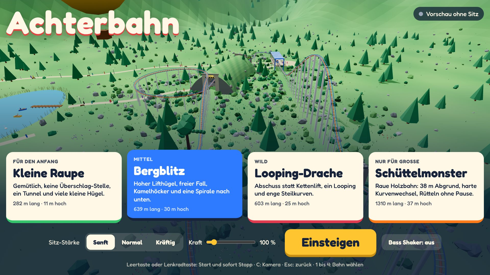
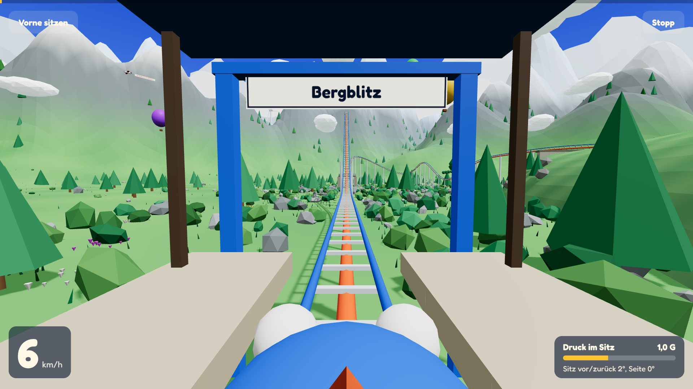
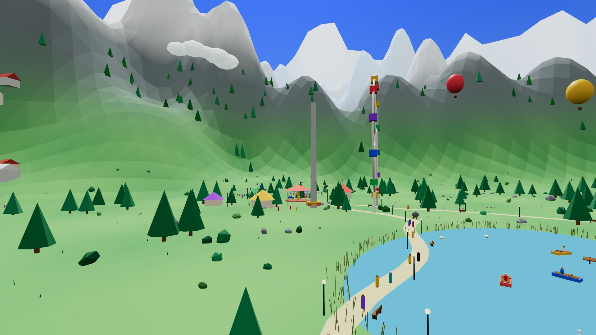
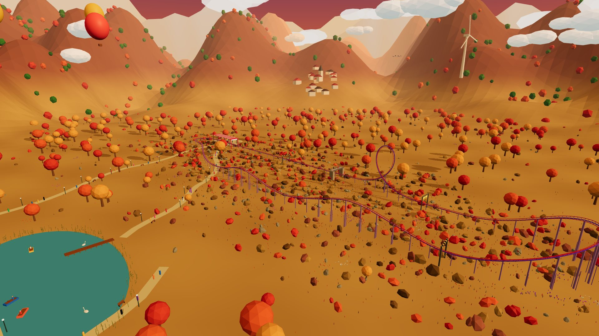

# RollercosterSim – Achterbahn für den Rennsitz

Ein Achterbahn-Simulator für den selbstgebauten 2DOF-Rennsitz. Das Spiel läuft auf dem PC in einem eigenen Fenster. SimHub bewegt dazu den Sitz, und auf Wunsch rüttelt der Bass Shaker mit. Gedacht ist das Ganze für gemeinsame Fahrten mit Kindern auf dem Sitz, der sonst für Assetto Corsa genutzt wird.



## Vorschau

| | |
|---|---|
|  |  |
| **Fahrt im ersten Wagen.** Unten links das Tempo, unten rechts der Druck im Sitz und wie weit der Sitz gerade kippt. | **Kulisse.** Berge mit Schneegipfeln, Jahrmarkt mit Riesenrad, Karussell und Freifallturm, See mit Booten, Ballons und Vögeln. |
|  | |
| **Looping-Drache.** Jede Bahn hat ihre eigene Landschaft und Tageszeit. | |

Die Seite gibt es auch als Artefakt auf claude.ai: [Achterbahn am Rennsitz](https://claude.ai/artifact/2yPbzCeWDJYeczUadGeAPE). Der Link ist privat und öffnet sich nur für den Besitzer. Dort läuft das Spiel als reine Vorschau ohne Sitz. Den Sitz bewegt nur die EXE aus diesem Repository.

## Die vier Bahnen

| Bahn | Für wen | Was passiert |
|---|---|---|
| Kleine Raupe | Für den Anfang | Gemütlich, ein Tunnel, viele kleine Hügel. 282 m, 11 m hoch. |
| Bergblitz | Mittel | Hoher Lifthügel, freier Fall, Kamelhöcker, Spirale nach unten. 639 m, 30 m hoch. |
| Looping-Drache | Wild | Abschuss statt Kettenlift, ein Looping, enge Steilkurven. 603 m, 25 m hoch. |
| Schüttelmonster | Nur für Große | Raue Holzbahn mit 38 m Abgrund und harten Kurvenwechseln. 1310 m, 37 m hoch. |

## Herunterladen und starten

1. Unter [Releases](../../releases) die neueste `Achterbahn-Windows.zip` herunterladen und entpacken.
2. SimHub starten.
3. `Achterbahn.exe` doppelklicken. Es öffnen sich ein schwarzes Konsolenfenster und das Spiel im Edge-Vollbild. Das Konsolenfenster offen lassen.
4. Oben rechts im Spiel muss „Sitz verbunden“ stehen.

Die EXE ist nicht signiert. Beim ersten Start warnt Windows: Rechtsklick auf die Datei, Eigenschaften, „Zulassen“ anhaken. Alternativ „Weitere Informationen“ und „Trotzdem ausführen“.

Bedienung, Startwerte und Sicherheitshinweise stehen in der [LIESMICH.txt](LIESMICH.txt).

## So hängt alles zusammen

```
┌──────────────────┐  WebSocket   ┌──────────────────┐   UDP 20790   ┌─────────┐  SMC3, COM4  ┌──────────────┐
│ Spiel im         │ ───────────▶ │ Achterbahn.exe   │ ────────────▶ │ SimHub  │ ───────────▶ │ Arduino Uno  │
│ Edge-Fenster     │ /telemetrie  │ (Brücke)         │  188 Bytes    │ Motion  │  500000 Baud │ 2 Wischer-   │
│                  │ ◀─────────── │                  │               │         │              │ motoren      │
└──────────────────┘ Status 1×/s  └──────────────────┘               └─────────┘              └──────────────┘
        │
        └── Bass Shaker: direkt aus dem Spiel über eine Soundkarte (Web Audio)
```

1. **Spiel.** Rechnet die Physik der Bahn und daraus, wie der Sitz kippen soll. Es schickt 31 Werte bis zu 125-mal pro Sekunde an die Brücke.
2. **Brücke.** `Achterbahn.exe` liefert das Spiel aus, nimmt die Werte an und packt sie in das Paketformat, das SimHub für eigene Spiele erwartet. Sie sendet alle 10 ms ein Paket.
3. **SimHub.** Kennt die Achterbahn als eigenes Spiel. Es wendet dein Motion-Profil an und steuert den Sitz über SMC3.
4. **Sitz.** Arduino mit Pololu-VNH5019-Shield regelt die beiden Wischermotoren über Potis. Details stehen im Rennsitz-Projekt.

## Ports

| Port | Art | Wer lauscht | Wozu |
|---|---|---|---|
| 8765 | TCP, HTTP | Achterbahn.exe, nur auf 127.0.0.1 | Liefert das Spiel ans Edge-Fenster aus: `http://127.0.0.1:8765` |
| 8765, Pfad `/telemetrie` | WebSocket | Achterbahn.exe | Spiel schickt die Bewegungsdaten, die Brücke meldet zurück, ob SimHub bereit ist |
| 20790 | UDP | SimHub | Empfängt die Bewegungsdaten als Spiel „Achterbahn“ |
| COM4 | seriell, 500000 Baud | Arduino | SimHub schickt die Motorpositionen im SMC3-Protokoll |

Alles läuft nur lokal auf dem PC. Es ist keine Freigabe in der Firewall oder im Router nötig.

## SimHub einrichten

SimHub ab Version 9.11.5 wird gebraucht.

1. `Achterbahn.exe` einmal starten. Sie legt die Spieldefinition unter `%LOCALAPPDATA%\SimHub\ExternalSims` an. Dabei rechnet sie mit SimHubs eigener Bibliothek die Kennung aus, an der SimHub die Pakete erkennt.
2. SimHub einmal neu starten und in der Spieleliste **Achterbahn** aktivieren.
3. Im Spiel steht jetzt „Sitz verbunden“. SimHub zeigt die Achterbahn als laufendes Spiel, sobald eine Fahrt beginnt.

Startwerte für Motion in SimHub, als Schätzung zum Nachfühlen:

| Effekt | Wert |
|---|---|
| Global | 50 % |
| Surge to Pitch | 100 % |
| Sway to Roll | 100 % |
| Pitch | 60 % |
| Roll | 60 % |
| Heave | 20 % |
| Yaw, Traction Loss | aus |

Kippt eine Richtung verkehrt herum, in SimHub bei dieser Achse das Vorzeichen umdrehen. Prüfe danach, dass die Werte für Assetto Corsa noch stimmen.

### Statusanzeige im Spiel

| Anzeige | Bedeutung |
|---|---|
| Sitz verbunden | Alles bereit |
| SimHub empfängt noch nicht | Brücke läuft, aber in SimHub ist das Spiel „Achterbahn“ nicht aktiviert |
| SimHub-Einrichtung fehlt | Die Kennung ließ sich nicht ausrechnen. Meldung im Konsolenfenster lesen, SimHub aktualisieren. |
| Vorschau ohne Sitz | Seite läuft ohne Brücke, zum Beispiel im Artefakt auf claude.ai |

## Was SimHub bekommt

Jedes Paket hat 188 Bytes im Format, das SimHub für External Sims vorgibt. Zuerst kommt ein Kopf mit Spielkennung, Paketzähler, Fahrt läuft und Pause. Dann folgen diese Felder:

- **Standardfelder:** Gier, Pitch und Roll in Grad samt Drehraten, Surge, Sway und Heave in m/s², Geschwindigkeiten, Position, km/h, Drehzahl, Antrieb, Bremse.
- **Eigene Felder:** Zeitstempel, Tempo in m/s und mph, Rumpeln, G-Kraft seitlich, nach oben und nach vorn, Kettenlift, Abschuss, Bremse, Schwerelos, Landung.

Pitch und Roll sind schon fertig gemischt. Der Sitz kippt am Lifthügel nach hinten und erst beim echten Fallen nach vorn. Die Stärke im Spiel, also „Sanft“, „Normal“, „Kräftig“ und der Kraft-Regler, wirkt zusätzlich zu den Gains in SimHub.

## Sicherheit

- Bei Stopp, Esc und am Fahrtende fährt der Sitz in 2,5 s weich in die Mitte.
- Hängt oder schließt die Seite, blendet die Brücke die Bewegung selbst auf null aus.
- Winkel, Kräfte und Stellgeschwindigkeit sind je Stärke begrenzt.
- Die Mechanik schützt das nicht: Kinderhände weg von Hebeln und Motoren, und niemand steht neben dem Sitz, solange er fährt.
- Vor einer Fahrt mit Kind erst ohne Mitfahrer „Sitz testen“ laufen lassen.

## Aufbau des Repositorys

| Ordner | Inhalt |
|---|---|
| `bridge/` | Windows-Programm in Go. `index.html` ist die fertige Spielseite und wird in die EXE eingebettet. |
| `web-quelltext/` | Lesbarer Quelltext der Spielseite, Stand 2.11.2026 |
| `docs/bilder/` | Vorschaubilder für diese Seite |
| `.github/workflows/` | Baut bei jedem Push die EXE. Mit einer Version beim manuellen Start entsteht ein Release. |

**Achtung:** `bridge/index.html` ist neuer als `web-quelltext/`. Kulisse, Kuppen-Fix und das neue Bewegungsmodell wurden direkt in der fertigen Seite geändert. Wer neu aus `web-quelltext/` baut, verliert diese Änderungen.

## Selbst bauen

```
cd bridge
GOOS=windows GOARCH=amd64 go build -trimpath -ldflags "-s -w" -o Achterbahn.exe .
```

Neue Version veröffentlichen: `RELEASE.md` anpassen und pushen. Dann unter **Actions**, „Windows-EXE bauen“, **Run workflow** mit einer Version wie `v1.1` starten. GitHub baut die EXE, legt den Tag an und hängt die ZIP an das Release. Ein gepushter Tag wie `v1.1` funktioniert genauso.
